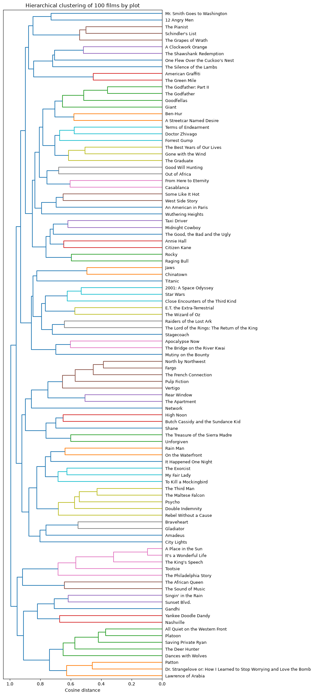

# Finding similar movies from their plot summaries

Uses TF-IDF, cosine similarity, k-means and hierarchical clustering on the plot summaries of 100 well-known films to find which ones tell similar stories.



## Data

`datasets/movies.csv`: title, genre and IMDb/Wikipedia plot summaries for 100 films. The data comes from the DataCamp project of the same name.

## Key results

- Sensible matches appear without any genre information: *The Godfather* with *Part II* and *Goodfellas*, *Braveheart* with *Gladiator*, and the war films together.
- The top-scoring pair is a false positive caused by shared character names ("George"), which shows the main weakness of bag-of-words similarity.

## Running the notebook

```bash
pip install -r requirements.txt
jupyter notebook notebook.ipynb
```

## License

The code is released under the [MIT License](LICENSE). Datasets keep the terms of their original sources, described above.
